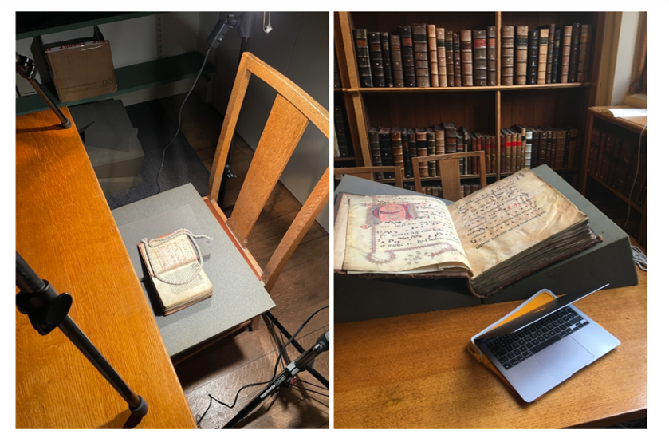
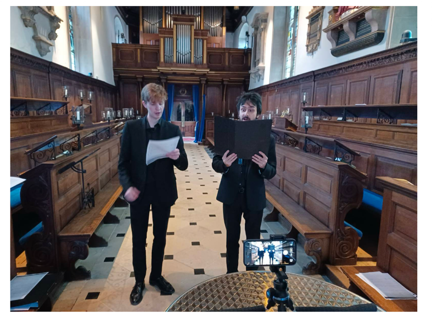
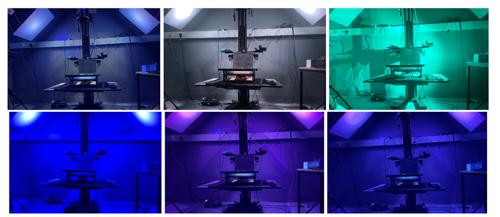

Cambridge libraries and archives are an extraordinary treasure chest for historical documents, and with that, also for manuscripts with early music notation. Whilst many documents are well preserved and allow research and discussion in their current form, there are also many cases where degradations over the centuries, e.g. physical or chemical processes, have rendered the notation illegible, making a complete reconstruction impossible. It was my hope with this project to bring together non-invasive image acquisition, advanced machine learning methods, and musical expertise to study some of the materials and bring them back to life. 

Applying mathematical research to musical cultural heritage data unites my academic work in image analysis with my career as a performing musician, where I am specialized in early music. Therefore, I was especially thrilled about the possibility that arose when I was awarded funding from the Accelerate-C2D3 funding call in 2024 to dive deeper into historical sheet music in Cambridge that could benefit from novel visualizations, making the invisible visible again. 

**A transdisciplinary research dream: From digging in libraries over imaging sessions to automating advanced expert-guided visualizations** 

The project was based at the Cambridge Image Analysis group and in collaboration with the Cambridge University Library, the Cultural Heritage Imaging Laboratory (CHIL) therein, the Fitzwilliam Museum, the Gonville & Caius Library and the Department of Music, first, musical fragments and manuscripts of interest were identified, subsequently, advanced image acquisition was conducted and novel automated image post-processing methods were developed based on feedback loops with musicologists and, lastly, finalized representations provided for transcription work. After this first project stage was finished, we developed a user-friendly toolbox together with a software engineer featuring our novel advanced visualization methods, which was made possible through a follow-on funding from the impact Accelerator scheme. 

First, together with my collaborators we have selected a choice of suitable music material that demonstrated the potential of being recoverable (for example, material with predominant holes would not have been suitable for this project) as well as being historically interesting. In the end, I focused mainly on examples from medieval times where some pieces include multiple independent voices to be performed simultaneously, so-called polyphony, which is still rare at that time period. 

**From reconstruction to recording 'O Felix Mortale' - an anonymous 13th century chant** 

")

As one of many case studies, I worked with an anonymous degraded fragment containing three 13th century chants with two voices, which marks early polyphony. The fragment is stored in the library of Gonville & Caius College Cambridge. It is vertically torn in two parts, and while one part remains legible, the damages on the other part render parts of the music notation illegible. The fragment was partially transcribed in 1970, but some parts remained blank/unsolved due to the severe degradations, so there was an opportunity to see whether our new methods could recover the remaining bits. I focused on the second chant 'O Felix Mortale', since that one is mainly notated on the degraded part of the fragment. As the fragment was imaged with both imaging systems it was possible to generate a wide variety of visualizations (described in the next section), highlighting different aspects. 

Eventually, the work on the medieval manuscript in collaboration with the musicologists Dr. Johanna-Pauline Thöne (Maynooth University Ireland) and PhD candidate Jack Stebbing (University of Cambridge), enabled the full transcription of 'O Felix Mortale', and subsequently, to be performed again - probably for the first time in centuries. It was a very special experience after all the work to hear it performed live in the chapel of Gonville & Caius College, where the fragment has been kept for so many years. You can watch the video of the performance on [YouTube.](https://www.youtube.com/watch?v=t0OzKoAYVdM)

**Our approach: Using new tools to unlock heritage data** 

To start the technical work, the first step was the imaging process, where we used an advanced imaging technique called multispectral imaging (MSI). MSI captures signal information across multiple predefined wavelength bands which can include wavelengths within and beyond the visible light spectrum, such as infrared and ultraviolet spectra. By analysing the spectral responses across these different bands, the technique may reveal features and characteristics that cannot be distinguished by the naked eye or through conventional visible-light imaging. In the project, we employed two imaging systems, a portable multispectral camera borrowed from the Fitzwilliam Museum that provides 8 frequency bands as well as the in-house system in the Cultural Heritage Imaging Laboratory (CHIL) - a much larger device capturing 49 band pass filters with higher resolution. Although the larger machine captures more information and detail, it cannot be moved. This is a disadvantage when working with manuscripts that cannot be transported because they are particularly valuable or fragile.

Ultimately, we acquired image data with both systems and started the analyses. First, with standard processing methods for MSI data and, subsequently, we developed our own advanced and experts-guided representations of the acquired data. We aimed to learn a combination of the frequency bands that integrates domain knowledge evaluating obtained reconstructions. Thereto, we focused on analytical methods that bring out the lost information by learning what is important, for example, suppressing bleed-through from the back of the folios or noise from the material itself whilst pushing the signal from the notation we aim to recover. To integrate expert's knowledge, we employed image quality measures that describe legibility through so-called annotation masks. These masks were created in a manual annotation process by our collaborating experts, labelling small regions regarding important signal information. 

 and background (blue) information. ")

Through this expert-guided process, we identified the information most relevant to the task at hand. Subsequently, we trained the method to automatically provide representations that focus on these key features and eliminate heuristics. With that, finally, sufficient enhancement of the degraded notation was possible and enabled in most of our case studies the reconstruction and transcriptions of the notation by musicologists.

Whilst these novel methods allow the enhancement depending on the state of degradation, we also experienced the impact of the imaging systems. Whenever possible the material was imaged with the in-house device of the CHIL, but there were also cases where this was not possible, for example, when the manuscript was too valuable to be moved. In those cases, we still experienced surprisingly helpful results with our methods in comparison to standard approaches. Nevertheless, we observed in the described case-study where imaging with both - the portable and in-house - devices was conducted, that the image data from the CHIL device provides more detailed information and the final reconstruction quality also highly depends on that, see Figure 6.

, reconstruction with standard methods and data from the portable imaging device (middle) and in the (bottom) reconstruction with our advanced methods on the image data from the CHIL in-house device.")

**Looking to the future** 

Our [CHARM toolbox](https://github.com/Accelerate-CambridgeCIA/charm-toolbox/releases/tag/v0.6.3) is now freely available, the toolbox allows users to see every processing step and also enables work beyond our use-cases with degraded music notation - it is tailored for enhancing legibility in any imaged document and, moreover, allows the processing of a whole manuscript at once.
Future work will include application of the methods developed within the toolbox to a broader range of case studies, encompassing diverse document types and characteristics, to further evaluate their applicability, robustness, and transferability.

**Acknowledgments**
The Accelerate-C2D3 funding enabled the project from conceptualization over imaging to research time for advanced reconstruction methods and lastly, the implementation and dissemination of the toolbox. The West Hub Small Grants Programme helped with funding for a "Workshop on Image Analysis for Manuscript Data (WIAM)" (Organizers: Anna Breger & Wallace Peaslee). 

Moreover, I thank the Master and Fellows of Gonville and Caius College for access to the manuscripts and permission to share the images (Figure 1, 2, 3 and 6), as well as the Parker Library, Corpus Christi College Cambridge, for access to the manuscript (Figure 5). 

Lastly, the project would not have been possible without my collaborators and I sincerely want to thank (alphabetically ordered) Tuija Ainonen, Sam Barrett, Mark Box, Karen Desmond, Flavia Fiorillo, Erma Hermens, Aleksandar Jovanovic, Matthew Martin, Evan Morgan, Suzanne Paul, Maciej Pawlikowski, Wallace Peaslee, Amelie Roper, Mark Statham, Carola-Bibiane Schönlieb, Jack Stebbing, Johanna-Pauline Thöne and everyone else who had been involved in the project.

*This project was funded though the [2024 Accelerate-C2D3 funding call for novel applications of AI for research and innovation](https://science.ai.cam.ac.uk/news/2024-12-09-exploring-novel-applications-of-ai-for-research-and-innovation-%E2%80%93-announcing-our-2024-funded-projects.html) and the[ 2025 Accelerate-C2D3 impact Accelerator call.](https://science.ai.cam.ac.uk/news/2025-11-26-ai-for-tomorrows-breakthroughs-15-new-projects-funded-to-transform-research)*